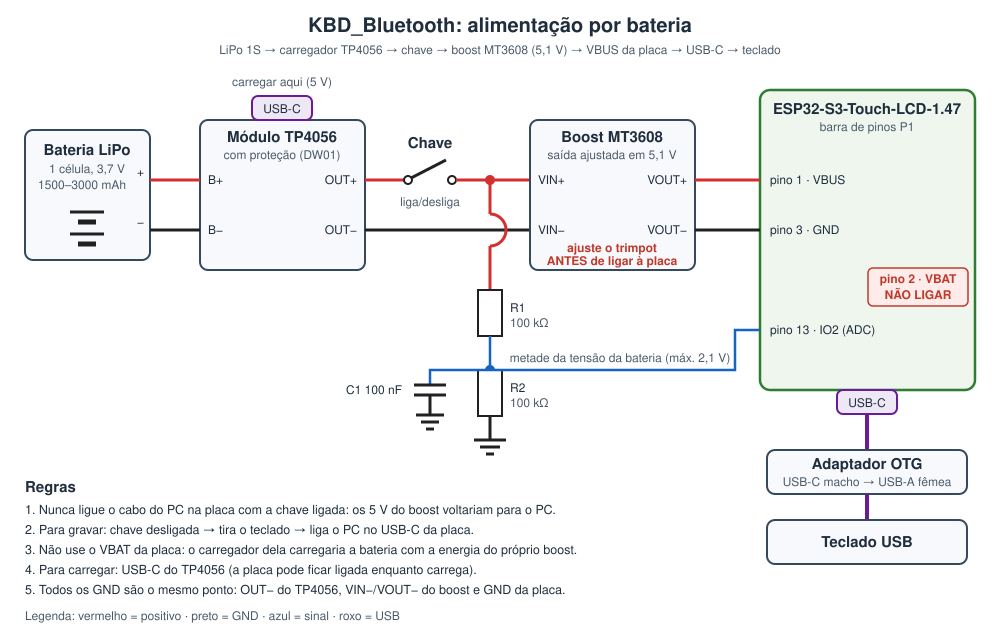

# KBD_Bluetooth

Este projeto transforma um **teclado USB com fio em teclado Bluetooth**. No caminho ele conta as
teclas, como o [KBD_AMOLED_164](https://github.com/srspinho/KBD_AMOLED_164), só que sem fio.

```
[Teclado USB] --USB host--> [ESP32-S3] --Bluetooth LE (HID)--> [PC / notebook / tablet / celular]
                                |
                      contagem, tela LCD
```

**Nada é instalado no PC.** Para o computador, o dispositivo é só um teclado Bluetooth comum.

## Por que ESP32-S3

O RP2350 usa duas USBs ao mesmo tempo: host para o teclado e device para o PC. O ESP32-S3 tem
uma única USB OTG, que faz um papel por vez. Aqui isso não é problema, porque:

- a **USB** fica só com o teclado (modo host);
- o **Bluetooth LE** faz o papel de "teclado" para o PC.

O ESP32-C3 e o C6 não têm USB OTG, e o S2 não tem Bluetooth. O S3 é o único da família que tem
as duas coisas.

## Placa

**Waveshare [ESP32-S3-Touch-LCD-1.47](https://www.waveshare.com/esp32-s3-touch-lcd-1.47.htm)**:
USB-C ligado à USB nativa do ESP32-S3, LCD de 1,47" (172×320) com controlador **JD9853**, touch
capacitivo AXS5106L e slot microSD. **Não tem LED RGB.**

| Função | GPIO |
|---|---|
| LCD MOSI / SCLK | 39 / 38 |
| LCD CS / DC / RST | 21 / 45 / 40 |
| LCD backlight | 46 |
| Touch AXS5106L (ainda não usado): SDA / SCL / RST / INT | 42 / 41 / 47 / 48 (endereço 0x63) |
| microSD por SPI (ainda não usado): CS / MOSI / SCLK / MISO | 14 / 15 / 16 / 17 |
| Botão BOOT | 0 |
| USB nativa (teclado) | 19 (D−) / 20 (D+), no próprio USB-C |
| Log serial (UART0) | 43 (TX) / 44 (RX) |

Todos os pinos ficam em **`placa.h`**. Se a imagem aparecer espelhada ou de cabeça para baixo,
troque `LCD_ROTACAO` (1 ↔ 3). Se aparecer uma faixa de lixo na lateral, ajuste `LCD_OFFSET_COLUNA`.

> As versões até a v0.1.1 estavam configuradas para outra placa, a ESP32-S3-LCD-1.47B (ST7789,
> pinos diferentes). Por isso a tela ficava vazia com o backlight aceso.

## Ligação do teclado e alimentação

O teclado vai no **USB-C da placa** por um **adaptador OTG** (USB-C macho → USB-A fêmea).

> ⚠️ **O ESP32 não gera os 5 V do teclado.** No modo host, a placa precisa *fornecer* 5 V no
> VBUS. Pelo [esquemático](https://files.waveshare.com/wiki/ESP32-S3-Touch-LCD-1.47/ESP32-S3-Touch-LCD-1.47-Schematic.pdf),
> o **pino 1 (VBUS)** da barra P1 é o **mesmo fio** do VBUS do USB-C. Então, 5 V no pino 1
> alimentam a placa **e** o teclado.

### Como a alimentação funciona na placa

```
USB-C VBUS ──┬── pino 1 da barra (VBUS)      ← os dois são o MESMO fio
             ├── carregador ETA6098 (carrega uma LiPo ligada no VBAT)
             └── diodo D1 ──► VCC5V ──► regulador 3,3 V ──► ESP32 e tela
VBAT (LiPo) ──── transistor Q1 ──► VCC5V  (só conduz quando NÃO há VBUS)
```

- **Nunca ponha 5 V no VBAT** (pino 2). Ele é o terminal de uma LiPo de 3,0 a 4,2 V e vai direto
  no carregador.
- Uma LiPo no VBAT alimenta **só a placa**: o VBUS fica sem tensão e o teclado não liga.

### Para testes: fonte de 5 V

| Fonte 5 V | Placa (barra P1) |
|---|---|
| +5 V | **pino 1 · VBUS** |
| GND | **pino 3 ou 4 · GND** |

Serve um carregador de celular ou um power bank, ligado por um cabo USB cortado ou por uma
plaquinha breakout USB.

### Versão com bateria



| Peça | Observação |
|---|---|
| LiPo 1 célula (3,7 V), 1500–3000 mAh | com fios; o tamanho cabe na caixa que fizermos |
| Módulo **TP4056 com proteção** (DW01 + 8205, entrada USB-C) | carrega a bateria e protege contra descarga profunda |
| Chave liga/desliga (deslizante) | entre o OUT+ do TP4056 e o VIN+ do boost |
| Módulo boost **MT3608** | regulável; **ajuste em 5,1 V com o multímetro antes de ligar à placa** |
| R1, R2 = 100 kΩ; C1 = 100 nF | divisor para medir a bateria no **IO2** (pino 13), ligado depois da chave |

**Ligações:**
1. Bateria + → **B+** do TP4056; bateria − → **B−**.
2. **OUT+** do TP4056 → chave → **VIN+** do MT3608; **OUT−** → **VIN−**.
3. **VOUT+** do MT3608 → **pino 1 (VBUS)** da placa; **VOUT−** → **pino 3 (GND)**.
4. Divisor: depois da chave → R1 → IO2 (pino 13) → R2 → GND, com C1 de IO2 para GND.
5. **VBAT da placa (pino 2) e conector de bateria da placa: não ligar nada.**

**Regras:**
- **Nunca ligue o cabo do PC na placa com a chave ligada.** Os 5 V do boost voltariam para a
  porta USB do PC.
- **Para gravar:** desligue a chave, tire o teclado e ligue o PC no USB-C da placa.
- **Para carregar:** use o USB-C do TP4056. A placa pode continuar ligada, mas com carga ligada o
  TP4056 às vezes não percebe o fim da carga. Para uma carga completa, desligue a chave.
- **Por que não usar o carregador da placa:** com o boost ligado ao VBUS, o carregador ETA6098 da
  placa carregaria a bateria com a energia do próprio boost, um círculo que só gasta bateria.

**Autonomia estimada** (sem economia de energia, que ainda vai ser implementada): a placa com
Bluetooth e tela gasta perto de 100 a 150 mA em 5 V. Somando a perda do boost, uma bateria de
2000 mAh dura de 6 a 8 horas. O consumo do teclado entra na conta: teclado simples sem LEDs fica
entre 5 e 30 mA, e teclados com RGB podem passar de 300 mA e esgotam a bateria rápido.

## Como compilar e gravar

**IDE Arduino 2.x**, com o core **esp32 da Espressif 3.x** (Gerenciador de Placas).

Bibliotecas (Gerenciador de Bibliotecas):
- **NimBLE-Arduino** 2.x (h2zero)
- **GFX Library for Arduino** (Arduino_GFX, moononournation)

Ferramentas → configurações da placa:

| Opção | Valor |
|---|---|
| Placa | **ESP32S3 Dev Module** |
| USB CDC On Boot | **Disabled** (a USB fica com o teclado; o log sai pela UART0) |
| USB Mode | Hardware CDC and JTAG |
| Flash Size | o da sua placa (veja a etiqueta do módulo ESP32-S3) |
| Partition Scheme | **Huge APP (3MB No OTA/1MB SPIFFS)** |
| PSRAM | conforme a placa (não é necessário nesta versão) |

**Gravar:** depois que este firmware está na placa, a USB vira host e o PC não vê mais a placa
sozinha. Para gravar de novo:

1. tire o teclado e ligue a placa no PC;
2. **segure o BOOT**, aperte e solte o **RESET** (ou ligue o cabo com o BOOT apertado) e solte o BOOT;
3. escolha a porta na IDE e grave;
4. aperte **RESET** para rodar.

(Uma versão futura terá atualização OTA pelo Wi-Fi.)

## Uso

1. Ligue o teclado e a alimentação. Na barra de cima da tela aparece **"BT parear"** (cinza):
   a placa está esperando o pareamento.
2. No PC, procure dispositivos Bluetooth e escolha **"KBD Bluetooth"**.
3. Quando aparecer **"BT OK"** (azul) e **"USB OK"** (verde), é só digitar.

| Barra de cima | Significado |
|---|---|
| `USB --` vermelho | sem teclado no USB |
| `BT parear` cinza | esperando o PC conectar/parear |
| `BT ...` amarelo | conectado, terminando o pareamento |
| `BT OK` azul | pronto |
| `A` / `1` amarelos | Caps Lock / Num Lock ligados |

Esta placa não tem LED RGB. O firmware tem o LED de status pronto: se você ligar um WS2812
externo, basta pôr o GPIO dele em `LED_RGB_PIN`, no `placa.h`.

**Parear com outro computador:** segure o **BOOT por 3 s** com o firmware rodando. Os pareamentos
são apagados e a placa volta a anunciar.

## Tela

- **Barra de cima:** estado do Bluetooth, teclado USB, Caps Lock (`A`) e Num Lock (`1`).
- **Centro:** teclas da sessão (desde que a placa ligou).
- **Embaixo:** total desde sempre, WPM (último minuto) e taxa de correção (Backspaces ÷ teclas,
  em laranja a partir de 10%).

A contagem segue a regra do KBD_AMOLED_164. Ela também guarda **quantas vezes cada tecla foi
apertada**, mas só a quantidade, nunca a ordem. O total e o mapa por tecla vão para a flash a
cada 5 min e sempre que a digitação para por 30 s, nunca a cada tecla.


### Diagnóstico do USB

A linha pequena abaixo do número grande mostra o último evento do USB:

| Mensagem | O que quer dizer |
|---|---|
| `aguardando teclado` | o USB host está ativo, mas nenhum aparelho respondeu: teclado sem energia (sem 5 V no VBUS) ou adaptador OTG com problema |
| `dispositivo N detectado` (e fica nisso) | o teclado foi visto, mas a leitura parou no meio |
| `sem teclado: 03/00/00 ...` | o aparelho não tem interface de teclado padrão; os números são classe/subclasse/protocolo de cada interface (mande para análise) |
| `XXXX:YYYY e um HUB` | teclado com hub interno: ainda não suportado |
| `falha no USB host (0x...)` | o USB host não iniciou; confira `USB Mode` nas configurações da placa |
| `XXXX:YYYY ok (...) rel N` | teclado montado; `rel` conta os relatórios recebidos e deve subir a cada tecla |

## Arquivos

| Arquivo | Função |
|---|---|
| `KBD_Bluetooth.ino` | setup/loop, LED de status (opcional), botão BOOT |
| `placa.h` | pinos e ajustes da placa |
| `usb_teclado.*` | USB host (driver `usb_host` do ESP-IDF): lê o teclado |
| `ble_teclado.*` | teclado BLE HID (NimBLE): manda as teclas ao PC |
| `estatisticas.*` | contagem de teclas, WPM, correção, gravação na flash |
| `tela.*` | LCD JD9853 (Arduino_GFX, com a inicialização do fabricante) |
| `log.*` | log pela UART0, seguro entre tarefas |

## Situação e próximos passos

**v0.2.0**: configurada para a ESP32-S3-Touch-LCD-1.47. Compila no core 3.3.11, e o Bluetooth já
aparece no Windows. A tela com o JD9853 e a leitura do teclado pelo USB ainda não foram testadas.

- [x] USB host lendo teclado no formato *boot* (praticamente todo teclado comum)
- [x] Teclado Bluetooth LE com pareamento salvo e LEDs Caps/Num Lock
- [x] Contagem: sessão, total, por tecla, WPM, taxa de correção
- [x] Tela de status
- [ ] Touch (AXS5106L): navegar por telas e menu
- [ ] Teclas de mídia e teclados NKRO/gamer (portar o parser de descritor HID do KBD_AMOLED_164)
- [ ] Teclados com hub interno
- [ ] Relógio (Wi-Fi/NTP) para a contagem **do dia**
- [ ] Ver as estatísticas pelo celular (serviço GATT ou página web pelo Wi-Fi)
- [ ] Remapeamentos (AltGr+R etc., como no KBD_AMOLED_164)
- [ ] Bateria: leitura da tensão (divisor no IO2), nível no Bluetooth e economia de energia
- [ ] Atualização OTA pelo Wi-Fi
- [ ] Mapa de teclas e screensavers na tela
